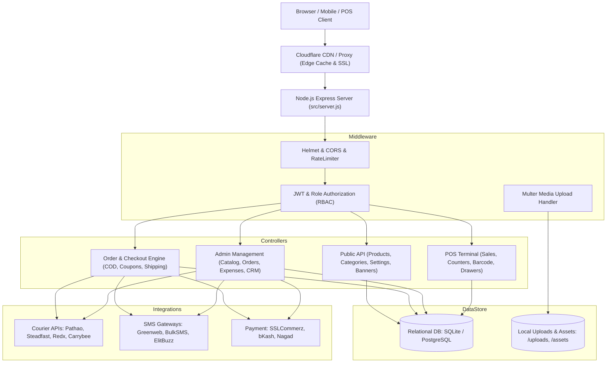

# Architecture Blueprint: Full-Stack E-Commerce & POS System

## 1. System Architecture Overview

The system is architected as a modular, decoupled full-stack TypeScript/Node.js web application with:
- **Presentation Layer**: Client-side React 18 SPA built with Vite, Tailwind CSS, Lucide Icons, and React Router.
- **Service/API Layer**: Node.js & Express.js REST application exposing structured JSON endpoints with CORS, rate-limiting, and JWT authentication.
- **Data Persistence Layer**: Relational Database Schema using SQLite (for local standalone deployment) and PostgreSQL/MySQL compatible schema for production scalability.
- **Asset Pipeline**: Static assets, uploaded product imagery, CDN caching, and responsive image srcset handlers.



---

## 2. Directory Structure

```text
E-commers rea/
├── .env.example                     # Environment template
├── .env                             # Active environment configuration
├── specs/
│   └── ecommerce_reverse_engineering_specification.md
├── docs/
│   └── ARCHITECTURE.md              # System design and blueprint
├── notes/
│   ├── PROJECT_STATE.md             # Real-time state ledger
│   └── AGENT_HANDOVER.md            # Resume directive
├── config/
│   └── policies.yaml                # Zero-Trust security rules
├── data/
│   ├── schema.sql                   # SQL DDL database definition
│   ├── seed.js                      # Database seeder from extracted data
│   ├── extracted_backend_data/      # JSON snapshots from target site
│   │   ├── settings.json
│   │   ├── categories.json
│   │   ├── banners.json
│   │   ├── products_summary.json
│   │   ├── products_details.json
│   │   ├── blog_posts.json
│   │   └── landing_pages.json
│   └── uploads/                     # Original target media files
├── src/
│   ├── server.js                    # Server entrypoint
│   ├── db/
│   │   └── database.js              # Database abstraction layer
│   ├── routes/
│   │   ├── public.js                # Public storefront & products
│   │   ├── auth.js                  # Authentication & customer accounts
│   │   ├── orders.js                # Checkout & orders engine
│   │   ├── admin.js                 # Admin management endpoints
│   │   └── pos.js                   # POS terminal endpoints
│   ├── services/
│   │   ├── orderService.js          # Order calculations & courier sync
│   │   ├── shippingService.js       # District & zone shipping rules
│   │   └── couponService.js         # Promotional voucher validation
│   └── public/
│       ├── index.html               # SPA entrypoint
│       ├── assets/                  # 120 client JS & CSS bundles
│       └── uploads/                 # Static media uploads
└── tests/
    └── api.test.js                  # Integration tests for core endpoints
```

---

## 3. Technology Stack & Pinned Versions

| Layer | Component | Version / Spec |
|---|---|---|
| Runtime | Node.js | v22.x LTS |
| Backend | Express.js | 4.21.2 |
| Database | SQLite3 / Better-Sqlite3 | 9.6.0 (or PostgreSQL 16) |
| Frontend | React | 18.3.1 |
| Build Tool | Vite | 5.x |
| Styling | Tailwind CSS | 3.4.x |
| Authentication | JSON Web Tokens (`jsonwebtoken`) | 9.0.2 |
| Security | Helmet & bcryptjs | 8.0.0 / 2.4.3 |
| Media Serving | Multer & Static Serve | 1.4.5-lts.1 |
