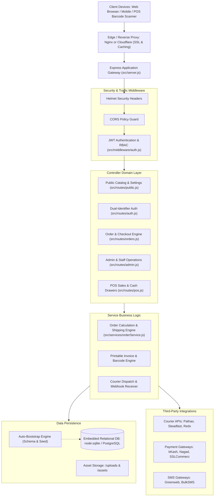
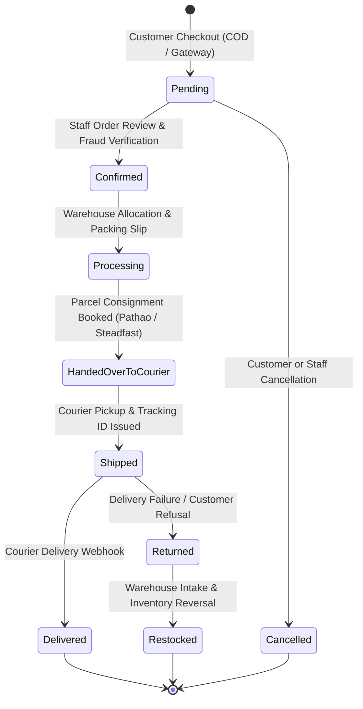
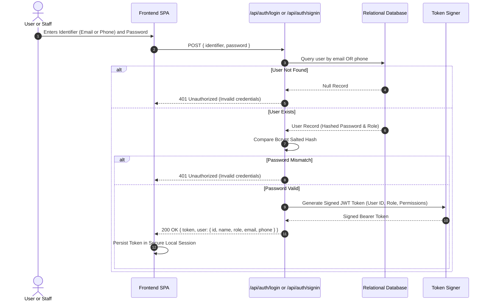
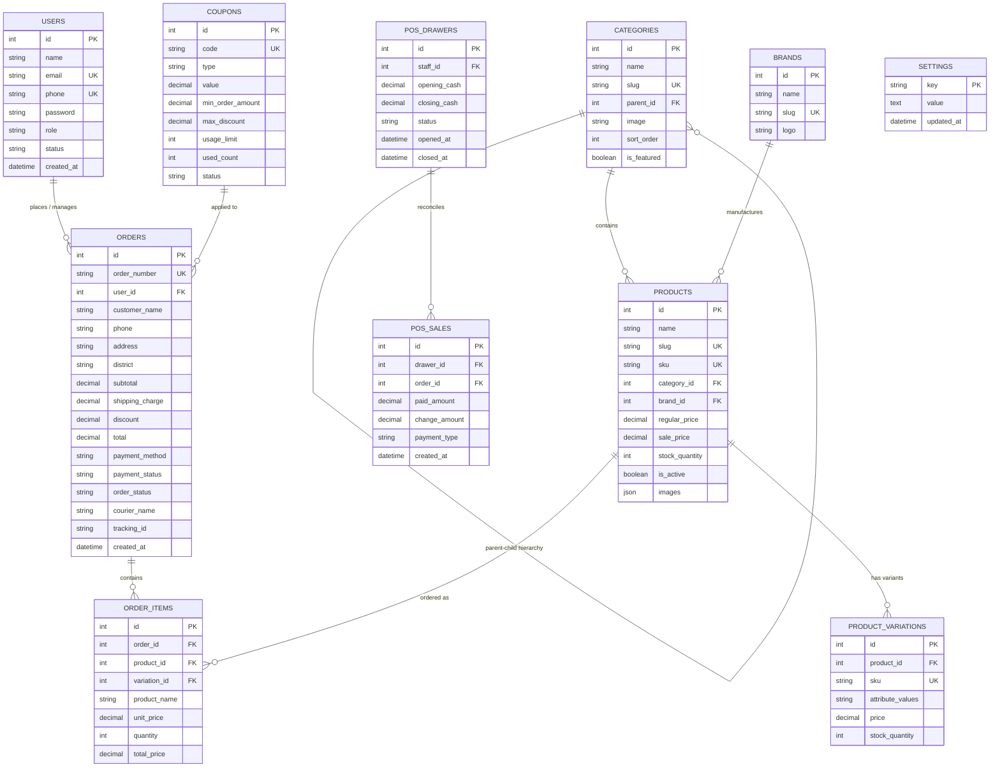

# Architecture Blueprint: Familio Bazar E-Commerce & POS Platform

---

## 1. System Architecture Overview

Familio Bazar is architected as an event-driven, decoupled modular web application designed for high-concurrency retail transactions, counter sales, and warehousing fulfillment. The system separates presentation, domain services, persistence, and external third-party integrations into distinct, loosely coupled layers.



---

## 2. Order Lifecycle State Machine

Orders transition through strict state transitions from creation to final delivery reconciliation.



---

## 3. Dual-Identifier Authentication Flow

The platform supports seamless dual-identifier sign-in, allowing users and staff to authenticate using either an email address or a valid Bangladeshi mobile number (`01XXXXXXXXX`).



---

## 4. Courier Logistics & Webhook Dispatch Pipeline

The logistics pipeline bridges internal warehouse fulfillment with external delivery carriers using normalized consignment structures.

```mermaid
flowchart LR
    subgraph InternalSystem["Familio Bazar Fulfillment"]
        AdminStaff["Fulfillment Staff"]
        OrderRecord["Order #DB-XXXX (Confirmed)"]
        DispatchEngine["Courier Dispatch Engine (orderService.js)"]
    end

    subgraph CourierNetwork["Courier APIs (Pathao / Steadfast / Redx)"]
        CourierAPI["Carrier Consignment Gateway"]
        CourierDelivery["Courier Field Rider"]
        WebhookNotifier["Carrier Webhook System"]
    end

    subgraph WebhookConsumer["Inbound Webhook Listener"]
        WebhookRoute["POST /api/webhooks/pathao"]
        StatusUpdater["Order Status & Tracking Sync"]
    end

    AdminStaff -->|Trigger Dispatch| DispatchEngine
    OrderRecord --> DispatchEngine
    DispatchEngine -->|Create Consignment POST| CourierAPI
    CourierAPI -->>|Return Consignment ID & Tracking URL| DispatchEngine
    DispatchEngine -->|Update Order Status to Shipped| OrderRecord
    CourierAPI --> CourierDelivery
    CourierDelivery -->|Customer Accepts Parcel| WebhookNotifier
    WebhookNotifier -->|POST Webhook Event: DELIVERED| WebhookRoute
    WebhookRoute --> StatusUpdater
    StatusUpdater -->|Mark Order as Delivered| OrderRecord
```

---

## 5. Database Entity-Relationship Model (ERD)

The relational schema is defined in `data/schema.sql`. It enforces referential integrity through foreign keys and cascading delete rules.



---

## 6. Zero-Trust Security & Threat Mitigation Standards

### Secrets Management
- No production secrets, private keys, or credentials are hardcoded into application source files or database seed artifacts.
- Credentials must be supplied via the environment (`.env`). The `.env.example` file uses standardized `[[VARIABLE_NAME]]` placeholders.
- The repository `.gitignore` strictly excludes `.env` and all SQLite database binary files (`*.sqlite`, `*.db`, `*.sqlite3`).

### Client-Side Trust Minimization
- Financial calculations (cart subtotal, coupon discounts, shipping rates, and taxes) are recomputed deterministically on the server inside `src/services/orderService.js`.
- Client-supplied line item prices are discarded in favor of current database catalog records to prevent price tampering attacks.

### Principle of Least Privilege
- Administrative APIs verify JWT signatures and extract user permissions on every request.
- Role checks prevent staff users from accessing super-admin configurations, payment gateway keys, or system-level settings.
