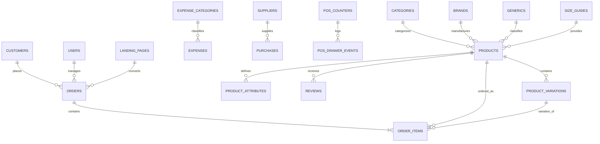

# E-Commerce Reverse Engineering & Full Reconstruction Specification

## 1. System Overview & Executive Summary
This document specifies the reverse engineering, extraction, architectural reconstruction, and re-implementation of the production e-commerce application deployed at `https://nodejs.topperit.com.bd/` (Digital Bazar - Fast Commerce).

The platform is a high-performance Bangladeshi e-commerce and retail system providing:
1. **Public Storefront**: Single Page Application (SPA) with server-assisted SEO prerendering, dynamic banners, category tree, multi-variation products, cart drawer, wishlists, flash sales, search, order tracking, and multi-language internationalization (`bn`, `en`, `ar`, `hi`, `fr`).
2. **Checkout & Conversion Engine**: Split-design high-converting checkout with cash-on-delivery (COD), online payment gateways (bKash, SSLCommerz), discount coupons, automated shipping rate calculation (inside/outside Dhaka, free shipping threshold), district/thana cascading selectors (`bdGeo`), and Facebook Conversions API (CAPI) client telemetry.
3. **High-Converting Landing Pages**: Dynamic marketing landing pages (`/lp/:slug`) with bespoke theme colors, hero sections, interactive review displays, video embeds, and one-click purchase flows.
4. **Administrative Control Suite**: Comprehensive management panel (`/admin`) for products, categories, attributes, generics, brands, orders, incomplete order recovery, customer CRM, sales reports, inventory ledger, courier shipping synchronization (Pathao, Steadfast, RedX, CarryBee), expenses, staff RBAC, SMS notifications, fraud mitigation, and theme customization.
5. **Point of Sale (POS) Terminal**: In-store sales terminal (`/pos`) supporting barcode scanning, cash drawer event auditing, held orders, customer/supplier ledgers, purchase returns, and thermal receipt printing.

---

## 2. API Contract & Endpoint Schema

### Public Customer Endpoints
- `GET /api/settings`: Comprehensive store parameters, theme options, navigation, checkout options, SEO, and payment configuration.
- `GET /api/categories`: Category taxonomy with `tree=1` nested parent-child hierarchy.
- `GET /api/banners`: Promotional sliders and image banners.
- `GET /api/brands`: Brand directory and product associations.
- `GET /api/generics`: Generic medicine / chemical / product generic classification.
- `GET /api/products`: Filterable product catalog (`limit`, `page`, `category`, `search`, `featured`, `newArrival`, `onSale`, `bestSeller`).
- `GET /api/products/:id`: Full single-product dossier including attributes, variations, size guides, reviews, and rating breakdown.
- `GET /api/blog`: Paginated blog articles and categories.
- `GET /api/blog/:slug`: Full blog post body, tags, and reading stats.
- `POST /api/blog/:slug/view`: Post read/view metric increment.
- `GET /api/lp/:slug`: Complete landing page schema and configuration.
- `POST /api/lp/:slug/view`: Landing page visitor telemetry.
- `POST /api/orders`: Order placement endpoint validating stock, discounts, and customer details.
- `GET /api/orders/track`: Order status tracking by phone or order number.
- `POST /api/coupons/validate`: Coupon validation checking expiry, order threshold, and usage limits.
- `GET /api/maintenance/status`: Maintenance window gating.
- `GET /api/cache-version`: Asset and cache invalidation timestamp.

### Customer Authentication & Profile
- `POST /api/auth/customer-login`: Mobile phone/password customer sign-in.
- `POST /api/auth/register`: Customer account creation.
- `POST /api/auth/forgot-password`: OTP/SMS reset code dispatch.
- `POST /api/auth/verify-reset-code`: Reset token confirmation.
- `POST /api/auth/reset-password`: Password update.
- `GET /api/account/me`: Authenticated customer profile & order history.
- `POST /api/account/wholesale/apply`: B2B wholesale customer registration.

### Point of Sale (POS) Endpoints
- `GET /api/pos/counter`: Current cash drawer counter status.
- `POST /api/pos/counter/open`: Open cash counter with initial cash float.
- `POST /api/pos/counter/close`: Reconcile end-of-day sales and cash float.
- `GET /api/pos/products`: Rapid barcode/SKU catalog lookup.
- `POST /api/pos/sale`: Instant POS order creation and receipt generation.
- `POST /api/pos/hold-order`: Store temporary customer cart state.
- `GET /api/pos/held-orders`: Retrieve unfinalized customer tickets.
- `GET /api/pos/drawer-events`: Audit cash additions, removals, and refunds.

### Administrative & Operations Endpoints
- `POST /api/auth/login`: Admin/Staff credential authentication (JWT issue).
- `GET /api/admin/catalog/summary`: Catalog KPI dashboard.
- `CRUD /api/admin/products`: Product CRUD, image uploads, variation matrices.
- `CRUD /api/admin/categories`: Category management with reordering.
- `CRUD /api/admin/orders`: Order management, courier assignment, status workflows.
- `POST /api/admin/orders/:id/courier-ship`: Dispatch to Pathao/Steadfast/Redx API.
- `POST /api/admin/orders/:id/courier-sync`: Refresh real-time courier delivery state.
- `CRUD /api/admin/customers`: Customer CRM and blacklist status.
- `CRUD /api/admin/expenses`: Operations cost logging and category classification.
- `CRUD /api/admin/coupons`: Promotion codes and discount campaigns.
- `CRUD /api/admin/landing-pages`: Visual landing page builder templates.
- `CRUD /api/admin/settings`: Live system settings update with instant persistence.

---

## 3. Database Entity Relationship Model (ERD)



---

## 4. Gherkin BDD Verification Scenarios

```gherkin
Feature: E-Commerce Storefront & Order Placement
  Scenario: Public visitor browse product and place Cash-On-Delivery order
    Given the backend server is running and database is seeded
    When a customer queries "GET /api/products?limit=10"
    Then the response status should be 200
    And the response should contain an array of products with prices, images, and stock
    When the customer submits an order via "POST /api/orders" with valid items and shipping address
    Then the response status should be 201
    And an order number should be generated
    And the order status should be "pending"
    And the product inventory stock should decrement accordingly

  Scenario: Discount coupon validation
    Given an active coupon "WELCOME10" with 10% discount and minimum order of 500 BDT
    When a customer checks "POST /api/coupons/validate" with subtotal 1000 BDT
    Then the coupon should be validated successfully
    And the discount amount should calculate to 100 BDT

  Scenario: POS cash counter session
    Given an authenticated POS cashier
    When the cashier opens a counter with opening cash 2000 BDT
    Then a new pos_counter session is created with status "open"
    When a walk-in sale of 1500 BDT is processed
    Then a drawer event of type "sale" is recorded
    And totalSales on the counter reflects 1500 BDT
```
